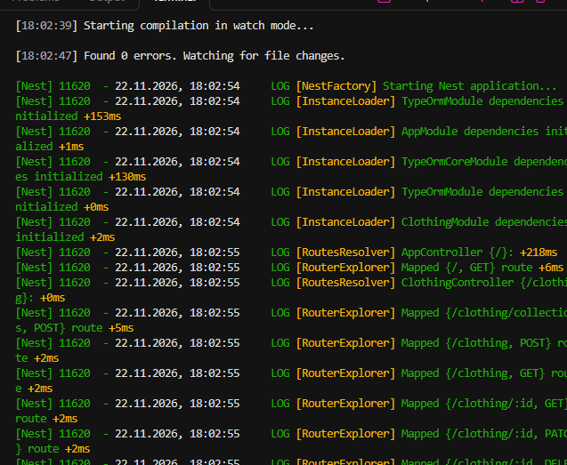
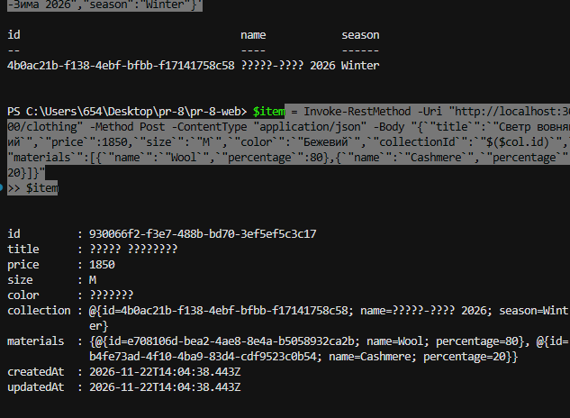
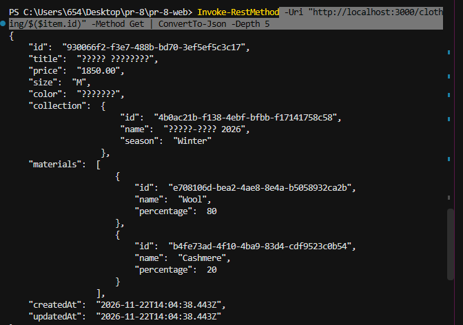
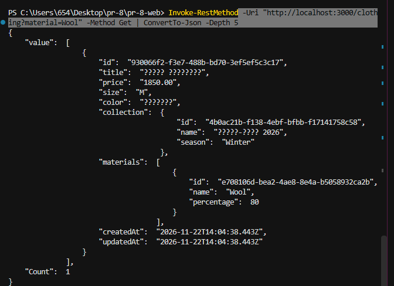

# Практична робота № 8
## Тема: Моделювання зв’язків між сутностями та керування міграціями

**Виконала:** Тирканич Корнелія, група КН-41

---

## Мета роботи

Опанувати принципи моделювання реляційних зв’язків між сутностями (One-to-Many / Many-to-One, Many-to-Many) в ORM TypeORM, навчитися налаштовувати каскадні операції збереження та видалення (`cascade`, `onDelete`), конфігурувати TypeORM CLI та DataSource для версіонування схеми бази даних через міграції (`migration:generate`, `migration:run`, `migration:revert`), а також будувати комплексні вибірки даних за допомогою QueryBuilder.

## Індивідуальний варіант № 3

**Домен: Інтернет-магазин одягу**

- Базова сутність: `ClothingEntity` — одяг.
- Зв’язок 1:M / M:1: `CollectionEntity` — сезонна колекція.
- Зв’язок M:N: `MaterialEntity` — склад тканин.

---

# 1. Хід виконання роботи

## 1.1. Конфігурація міграцій та DataSource (Рівень 1)

Для керування структурою бази даних PostgreSQL `store_pr8_db` (порт `5433`) було вимкнено автоматичну синхронізацію схеми за допомогою параметра `synchronize: false` у файлі `src/app.module.ts`.

Це дозволяє уникнути неконтрольованих змін структури бази даних і використовувати міграції TypeORM для керування її версіями.

Створено конфігураційний файл `src/database/data-source.ts`:

```typescript
import { DataSource } from 'typeorm';
import { config } from 'dotenv';

config();

export default new DataSource({
  type: 'postgres',
  host: process.env.DB_HOST || 'localhost',
  port: parseInt(process.env.DB_PORT || '5433', 10),
  username: process.env.DB_USER || 'postgres',
  password: process.env.DB_PASSWORD || '12345678',
  database: process.env.DB_NAME || 'store_pr8_db',
  entities: ['src/**/*.entity.ts'],
  migrations: ['src/database/migrations/*.ts'],
  synchronize: false,
});
```

У `package.json` додано npm-скрипти для роботи з міграціями:

```json
{
  "typeorm": "typeorm-ts-node-commonjs -d src/database/data-source.ts",
  "migration:generate": "npm run typeorm -- migration:generate",
  "migration:run": "npm run typeorm -- migration:run",
  "migration:revert": "npm run typeorm -- migration:revert"
}
```

## 1.2. Моделювання зв’язку One-to-Many / Many-to-One

Було створено дві сутності:

- `CollectionEntity` — сезонна колекція одягу (таблиця `collections`).
- `ClothingEntity` — товар одягу (таблиця `clothing`).

Одна колекція може містити багато товарів, але кожен товар належить до однієї колекції або може не мати її.

У `CollectionEntity` реалізовано зв’язок:

```typescript
@OneToMany(
  () => ClothingEntity,
  (clothing) => clothing.collection
)
clothes: ClothingEntity[];
```

У `ClothingEntity` реалізовано зворотний зв’язок:

```typescript
@ManyToOne(
  () => CollectionEntity,
  (collection) => collection.clothes,
  {
    onDelete: 'CASCADE',
    nullable: true
  }
)
@JoinColumn({ name: 'collection_id' })
collection: CollectionEntity;
```

Параметр `onDelete: 'CASCADE'` забезпечує автоматичне видалення пов’язаних товарів у разі видалення колекції.

Параметр `nullable: true` дозволяє створювати товари без прив’язки до сезонної колекції.

## 1.3. Моделювання зв’язку Many-to-Many

Для опису складу тканин створено сутність `MaterialEntity` (таблиця `materials`) із полями:

- `id` — унікальний ідентифікатор;
- `name` — назва матеріалу;
- `percentage` — відсоток матеріалу у складі тканини.

Між `ClothingEntity` та `MaterialEntity` реалізовано зв’язок Many-to-Many.

Один товар може складатися з декількох матеріалів, а один матеріал може використовуватися у багатьох товарах.

У `ClothingEntity` додано:

```typescript
@ManyToMany(
  () => MaterialEntity,
  (material) => material.clothes,
  { cascade: true }
)
@JoinTable({
  name: 'clothing_materials',
  // Налаштування колонок проміжної таблиці
})
materials: MaterialEntity[];
```

У `MaterialEntity` реалізовано зворотний зв’язок:

```typescript
@ManyToMany(
  () => ClothingEntity,
  (clothing) => clothing.materials
)
clothes: ClothingEntity[];
```

Для зберігання зв’язків між товарами та матеріалами створюється проміжна таблиця `clothing_materials`.

Параметр `cascade: true` дозволяє автоматично зберігати нові пов’язані матеріали під час створення товару.

## 1.4. Керування життєвим циклом міграцій

За допомогою TypeORM CLI виконано основні операції керування міграціями.

**1. Генерація міграції**

Створення міграції для таблиць `collections`, `clothing`, `materials`, проміжної таблиці `clothing_materials` та зовнішніх ключів:

```powershell
npm run migration:generate -- src/database/migrations/CreateRelations
```

**2. Застосування міграції**

Внесення змін до бази даних `store_pr8_db`:

```powershell
npm run migration:run
```

**3. Відкат міграції**

Перевірка можливості повернення до попередньої структури бази даних:

```powershell
npm run migration:revert
```

**4. Повторне застосування міграції**

```powershell
npm run migration:run
```

У результаті було перевірено генерацію, застосування та відкат міграцій TypeORM.

### Результат у pgAdmin 4

У базі даних перевірено наявність таких таблиць:

- `collections`;
- `clothing`;
- `materials`;
- `clothing_materials`;
- `migrations`.

**Місце для скріншота:**


## 1.5. Отримання зв’язаних даних та фільтрація через QueryBuilder

У `ClothingService` та `ClothingController` реалізовано ендпоінти для роботи зі зв’язаними сутностями.

**Отримання товару за UUID**

```http
GET /clothing/:id
```

Для завантаження товару разом із пов’язаною колекцією та матеріалами використовується параметр:

```typescript
relations: ['collection', 'materials']
```

**Фільтрація товарів за матеріалом**

```http
GET /clothing?material=Wool
```

Для реалізації динамічної фільтрації використовується `createQueryBuilder()`:

```typescript
const query = this.clothingRepository
  .createQueryBuilder('clothing')
  .innerJoinAndSelect('clothing.materials', 'material')
  .leftJoinAndSelect('clothing.collection', 'collection')
  .where('material.name = :material', { material });

return query.getMany();
```

У запиті використовуються:

- `innerJoinAndSelect()` — об'єднання з таблицею матеріалів;
- `leftJoinAndSelect()` — отримання інформації про сезонну колекцію;
- `where()` — фільтрація за назвою матеріалу;
- `getMany()` — отримання списку знайдених товарів.

Параметризована умова допомагає уникнути безпосередньої підстановки користувацького введення в SQL-запит.

---

# 2. Результати тестування API

Після запуску NestJS-сервера:

```powershell
npm run start:dev
```

Працездатність зв’язків між сутностями та API перевірено за допомогою HTTP-запитів.

| HTTP-метод | Ендпоінт | Призначення | Результат |
|---|---|---|---|
| POST | `/clothing/collections` | Створення сезонної колекції Winter | 201 Created |
| POST | `/clothing` | Створення товару з колекцією та матеріалами | 201 Created |
| GET | `/clothing/:id` | Отримання товару з пов'язаними сутностями | 200 OK |
| GET | `/clothing?material=Wool` | Фільтрація товарів за матеріалом | 200 OK |

## 2.1. Створення сезонної колекції

Виконано POST-запит:

```http
POST /clothing/collections
```

У результаті створено сезонну колекцію `Winter`.

Отриманий UUID:

```text
4b0ac21b-f138-4ebf-bfbb-f17141758c58
```

Результат: `201 Created`.

## 2.2. Створення товару з матеріалами

Виконано POST-запит:

```http
POST /clothing
```

Для товару передано ідентифікатор колекції та масив матеріалів:

```json
{
  "materials": [
    {
      "name": "Wool",
      "percentage": 80
    },
    {
      "name": "Cashmere",
      "percentage": 20
    }
  ]
}
```

Завдяки `cascade: true` нові матеріали було збережено автоматично.

Отриманий UUID товару:

```text
930066f2-f3e7-488b-bd70-3ef5ef5c3c17
```

Результат: `201 Created`.

## 2.3. Отримання товару зі зв’язаними сутностями

Виконано GET-запит:

```http
GET /clothing/930066f2-f3e7-488b-bd70-3ef5ef5c3c17
```

Результат: `200 OK`.

У відповіді отримано інформацію про товар, вкладений об'єкт сезонної колекції та масив матеріалів.

## 2.4. Фільтрація товарів через QueryBuilder

Виконано запит:

```http
GET /clothing?material=Wool
```

Результат: `200 OK`.

У відповідь повернуто список товарів, які містять матеріал `Wool`.

**Кількість знайдених товарів: 1.**

### Скріншоти тестування














---

# 3. Висновки

У ході виконання практичної роботи № 8 було вдосконалено архітектуру бекенд-застосунку інтернет-магазину одягу на базі NestJS, TypeORM та PostgreSQL.

Було налаштовано `DataSource` для роботи TypeORM CLI, вимкнено автоматичну синхронізацію структури бази даних за допомогою `synchronize: false` та реалізовано версіонування схеми через міграції `migration:generate`, `migration:run` і `migration:revert`.

Реалізовано реляційні зв’язки One-to-Many / Many-to-One між `CollectionEntity` та `ClothingEntity`, а також Many-to-Many між `ClothingEntity` та `MaterialEntity`. Налаштовано каскадне видалення `onDelete: 'CASCADE'` та каскадне збереження `cascade: true`.

Також було створено проміжну таблицю `clothing_materials`, реалізовано завантаження пов'язаних даних через `relations` та побудовано фільтрацію товарів за матеріалами за допомогою QueryBuilder.

У результаті роботи закріплено практичні навички проєктування реляційних зв’язків, керування міграціями бази даних та створення складних запитів у TypeORM.

---

**Технології:** TypeScript, NestJS, TypeORM, PostgreSQL, Node.js, pgAdmin 4.